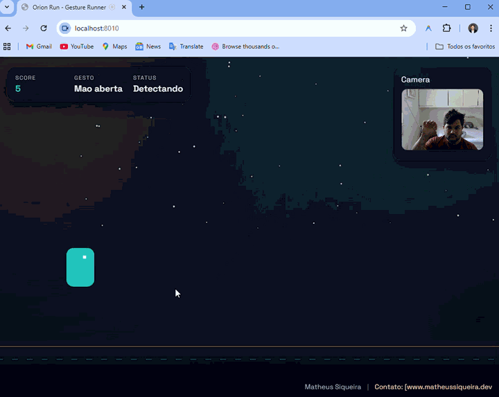

# Orion Run Pro

Runner fullstack inspirado no Dino Chrome, reestruturado para padrao profissional de produto: frontend modular, backend escalavel, API versionada, testes automatizados, UX moderna e foco em performance, acessibilidade e manutencao.



## Visao geral do produto
Orion Run Pro e um jogo casual para navegador com dois modos de controle:
- Teclado
- Gestos por webcam (MediaPipe)

Publico-alvo:
- Portfolios de engenharia e design
- Estudos de game loop e visao computacional
- Projetos demonstrativos com arquitetura fullstack real

Objetivo de negocio:
- Entregar um case robusto, com UX refinada e base tecnica pronta para evolucao de produto.

## Diagnostico tecnico aplicado
Problemas encontrados na base original:
- Estrutura monolitica em um unico arquivo JS
- Ausencia de backend/API real
- Sem camada de dados persistente
- Sem testes automatizados
- Fluxo de UX limitado a tela inicial/fim
- Sem contrato de API, sem versionamento e sem seguranca basica

Melhorias entregues:
- Arquitetura em camadas no backend (config, middleware, controller, service, repository, validation)
- Frontend modular com separacao entre dominio, infraestrutura, apresentacao e aplicacao
- Leaderboard persistente via API REST `/api/v1`
- Validacao forte de dados com `zod`
- Autorizacao administrativa para reset de ranking (`x-admin-key`)
- Tratamento centralizado de erros + request id + logging HTTP
- UX/UI redesenhada com design system, responsividade e microinteracoes
- Acessibilidade: alto contraste, reduced motion, foco visivel
- Testes unitarios e de integracao em Node Test Runner

## Arquitetura e decisoes tecnicas
### Backend
Padrao adotado:
- `Controller` recebe HTTP
- `Service` aplica regras de negocio
- `Repository` persiste dados em arquivo JSON
- `Validation` garante contrato de entrada
- `Middleware` centraliza seguranca, erros, auth e observabilidade

Principios aplicados:
- SOLID: responsabilidades isoladas por camada
- DRY: validacoes e middlewares reutilizaveis
- Clean Architecture (adaptado): dominio desacoplado de detalhes de transporte/persistencia

### Frontend
Separacao principal:
- `application`: orquestracao (`GameEngine`)
- `domain`: entidades e regras de colisao/obstaculos
- `infrastructure`: teclado, gestos e cliente HTTP
- `presentation`: canvas renderer e controlador de UI
- `core/config`: utilitarios e configuracoes

Beneficios:
- Evolucao mais segura
- Menor acoplamento
- Facilidade para adicionar novas features (modos, power-ups, novos endpoints)

## Stack utilizada
- Node.js 20+
- Express 5
- Helmet, CORS, Compression
- Zod
- Pino HTTP
- HTML5, CSS3, JavaScript ES Modules
- Canvas 2D
- MediaPipe Hands
- Node Test Runner (`node:test`)

## Estrutura do projeto
```text
.
|-- client/
|   |-- index.html
|   |-- assets/
|   `-- src/
|       |-- application/
|       |-- config/
|       |-- core/
|       |-- domain/
|       |-- infrastructure/
|       `-- presentation/
|-- server/
|   |-- data/
|   |-- src/
|   |   |-- config/
|   |   |-- controllers/
|   |   |-- errors/
|   |   |-- middleware/
|   |   |-- repositories/
|   |   |-- routes/
|   |   |-- services/
|   |   `-- validation/
|   `-- tests/
|-- package.json
`-- README.md
```

## API e contratos
Base URL: `http://localhost:8080/api/v1`

Endpoints:
- `GET /health`
  - Health check do servico
- `GET /leaderboard?limit=10`
  - Lista top scores
- `POST /leaderboard`
  - Cria score no ranking
  - Payload:
    - `playerName` (2-20 chars)
    - `score` (int >= 0)
    - `difficulty` (`easy|normal|hard`)
    - `controlMode` (`keyboard|gesture`)
    - `durationMs` (opcional)
- `DELETE /leaderboard`
  - Reset de ranking
  - Requer header: `x-admin-key`

## Seguranca, confiabilidade e observabilidade
- `helmet` com politicas de seguranca para scripts/fontes
- `cors` configuravel por ambiente
- Body size limit para prevenir abuso de payload
- Sanitizacao e validacao de entrada
- Autorizacao para operacoes administrativas
- Request ID por requisicao (`x-request-id`)
- Logs estruturados para auditoria e troubleshooting

## UX/UI e performance
- Nova hierarquia visual com design system de tokens (cores, espacos, tipografia)
- Responsivo para desktop e mobile
- Renderizacao em canvas com `requestAnimationFrame` e delta-time
- Evita atualizacao de DOM redundante no HUD
- Preferencias persistidas em `localStorage`:
  - Nome do jogador
  - Alto contraste
  - Reduced motion
  - Melhor score local

## Como instalar e executar
### 1) Instalar dependencias
```bash
npm install
```

### 2) Rodar em desenvolvimento
```bash
npm run dev
```

### 3) Rodar em producao local
```bash
npm start
```

Aplicacao disponivel em:
- `http://localhost:8080`

Observacao sobre camera:
- Webcam exige contexto seguro (`localhost` ou `https`).

## Testes
Executar suite automatizada:
```bash
npm test
```

Cobertura atual de testes:
- Unitario: regras de servico do leaderboard
- Integracao: fluxos reais da API (health, create/list, validacao, auth)

## Deploy (guia rapido)
### Render / Railway / VPS
1. Defina variaveis de ambiente:
   - `NODE_ENV=production`
   - `PORT=8080` (ou fornecida pelo provedor)
   - `ADMIN_API_KEY=<chave-forte>`
   - `CORS_ORIGIN=<dominio-frontend>`
2. Execute:
   - `npm ci`
   - `npm start`
3. Publique com HTTPS habilitado.

## Boas praticas adotadas
- Separacao de responsabilidades por camada
- Contratos de API versionados
- Validacao e erros padronizados
- Evolucao orientada a testes
- Estrutura preparada para crescimento incremental

## Melhorias futuras
- Autenticacao de usuarios (JWT/OAuth)
- Persistencia em banco relacional (PostgreSQL)
- Cache de ranking (Redis)
- Modo torneio com temporadas
- Dashboard de analytics e monitoramento (OpenTelemetry + Grafana)
- Testes E2E completos (Playwright)

Autoria: Matheus Siqueira  
Website: https://www.matheussiqueira.dev/